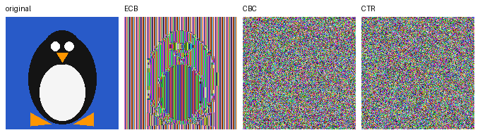

# Chapter 5: More About Block Ciphers (Modes of Operation)

Code: [`ecb_penguin.py`](../src/cryptolab/ch05/ecb_penguin.py), [`gcm.py`](../src/cryptolab/ch05/gcm.py),
[`tls_audit.py`](../src/cryptolab/ch05/tls_audit.py), [`secure_log.py`](../src/cryptolab/ch05/secure_log.py) ·
Tests: [`tests/ch05`](../tests/ch05)

## 5.1 ECB's penguin problem



A flat-colour 160×160 mascot encrypted with AES under the same key in three modes (`python -m cryptolab.ch05.ecb_penguin`).
**ECB** encrypts each 16-byte block independently, so identical plaintext blocks become identical ciphertext blocks: the
penguin's outline is plainly visible, with only the *colours* scrambled. Measured: **4,674 of 4,800 blocks are repeats** of an
earlier block in the ECB output, versus **0** for CBC and CTR. **CBC** XORs each plaintext block with the previous ciphertext
block (seeded by a random IV) before encrypting, and **CTR** XORs the data with a keystream built from a unique counter per
block, so equal plaintext blocks no longer produce equal ciphertext and the output is indistinguishable from noise. ECB
is dangerous whenever data has repetition (images, tables, headers, zero padding); it is only acceptable for a single
random block, such as wrapping a key.

## 5.3 Authenticated encryption: GCM, and what happens without it

`gcm.py` builds AES-GCM from the chapter-4 AES: CTR-mode encryption plus **GHASH**, a polynomial MAC over GF(2^128) keyed
by `H = AES_K(0)`. It reproduces the published GCM test cases 1-3 and matches the library on random inputs (tests).

```
GCM round-trip: b'PAY ALICE $100.00'
GCM, bit flipped in ciphertext -> AuthenticationError - tag mismatch: message was modified
CTR (no MAC), same flip -> silently decrypts to: b'PAY ALICE $900.00'
```

Flipping one ciphertext bit **in GCM** fails tag verification and no plaintext is returned (verify first, decrypt second).
In **unauthenticated CTR**, the same flip changes exactly the corresponding plaintext bit: an attacker who can guess that
byte 11 is `'1'` turns `$100` into `$900` *without knowing the key*. Confidentiality does not give integrity; encryption
without authentication is malleable. (Unauthenticated CBC fails differently: a flipped bit garbles one block and flips the
same bit in the next, and padding errors even leak a decryption oracle, the subject of the padding-oracle attack.)

## 5.5 TLS audit

`tls_audit.py` probes protocol versions, tries **every cipher suite offered by the local OpenSSL (137) individually** against
TLS 1.2, inspects the certificate and reads security headers. Run only against hosts you own: both below are this project's
own deployments. Results, 2026-10-21:

| | `ncf-website-ten.vercel.app` | `signalmap-8117.onrender.com` |
|---|---|---|
| TLS 1.0 / 1.1 | refused by server | refused by server |
| TLS 1.2 / 1.3 | supported / supported | supported / supported |
| TLS 1.2 suites accepted | 3 of 137, all ECDHE + AEAD (AES-GCM, ChaCha20) | 6 of 137, all ECDHE + AEAD |
| Certificate | RSA 2048, SHA-256, Google Trust Services, 36 days left (platform auto-renews) | EC P-256, ECDSA-SHA256, Google Trust Services, 60 days left |
| Headers present | Strict-Transport-Security | Strict-Transport-Security, X-Content-Type-Options |

**Findings.** No weak protocols or suites: nothing to disable. Remaining gaps are response headers, not TLS:

1. **NCF site** (static export on Vercel): add the missing security headers in `vercel.json`:
   ```json
   {"headers": [{"source": "/(.*)", "headers": [
     {"key": "X-Content-Type-Options", "value": "nosniff"},
     {"key": "X-Frame-Options", "value": "DENY"},
     {"key": "Referrer-Policy", "value": "strict-origin-when-cross-origin"},
     {"key": "Permissions-Policy", "value": "camera=(), microphone=(), geolocation=()"}]}]}
   ```
2. **SignalMap** (Render static site): add the same set except `nosniff` (already present) through `render.yaml`:
   ```yaml
   headers:
     - {path: /*, name: X-Frame-Options, value: DENY}
     - {path: /*, name: Referrer-Policy, value: strict-origin-when-cross-origin}
   ```
3. Both: consider a Content-Security-Policy after testing (the NCF site uses Google Fonts and WhatsApp links).
4. Keep HSTS and consider adding the domain to the HSTS preload list once every subdomain serves HTTPS.

**Limits of the tool (stated so the result is not over-trusted).** TLS 1.3 suites cannot be enumerated with this method;
it probes what *this machine's* OpenSSL can offer (a sensible fallback reports "cannot test" instead of guessing); it does
not check OCSP stapling, certificate transparency, renegotiation or known-vulnerability tests (Heartbleed, ROBOT, ...).
Confirm with `testssl.sh` or SSL Labs before sign-off.

## 5.6 Secure logging: design and prototype

**Scenario.** A service writes audit logs containing user IDs and amounts to disk shared with operators and backup systems.
**Threats:** a reader of the files/backups (confidentiality); an attacker with write access who edits, reorders, replays,
deletes or truncates records to hide activity (integrity).

| Decision | Choice | Why |
|---|---|---|
| Mode | **AES-256-GCM** | One primitive gives confidentiality *and* integrity, fast, widely vetted. CBC+HMAC works but is more to get wrong; AES-GCM-SIV is the upgrade if nonce uniqueness cannot be guaranteed. |
| Keys | Master key held outside the log host; **per-segment key = HKDF(master, "log-enc\|segment")** | A leaked segment key exposes one segment, rotation is "start a new segment", and per-segment keys make counter nonces safe. |
| Nonce | The **96-bit record sequence number** | Unique per (segment key, record) by construction; no RNG needed. Requires a single writer (file lock in the prototype) and the sequence is recovered from the file itself after a crash. |
| Order, deletion, replay | Associated data = segment id ‖ sequence ‖ **SHA-256 of the previous record line** | A hash chain: deleting, reordering or duplicating any record changes what the next record was bound to, so it fails to decrypt. |
| Tail truncation | **MAC'd checkpoint** (record count + chain head) kept off-host | Nothing inside the file can reveal that the *last* records were cut off; an external anchor can. |

Prototype tests (all pass): round trip and resuming after reopen; a flipped bit, a deleted record, reordered records and a
replayed record are each rejected with the offending index; **truncating the tail is invisible without a checkpoint** (the
test asserts that limitation on purpose) and detected with one; wrong key, wrong segment, and a second concurrent writer
(blocked by the lock) all fail. **Not covered:** an attacker who also holds the master key can forge everything; key
management, log shipping and clock integrity are out of scope.
